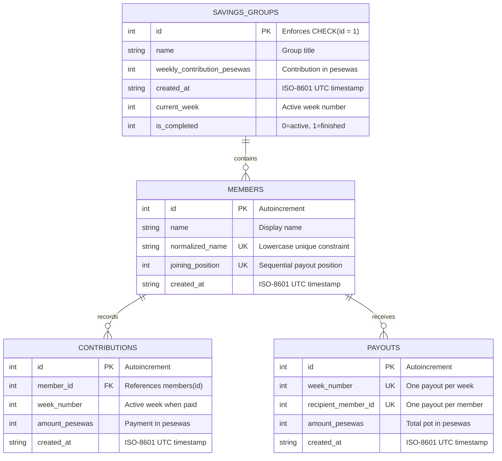

<div align="center">

# 🇬🇭 SusuTurn

### Professional Rotating Savings Group Management System
#### *Contribute Together. Receive in Turn.*

[](https://python.org)
[](https://github.com/brainiacweb-tech/susuturn)
[](https://sqlite.org)
[](https://github.com/brainiacweb-tech/susuturn/blob/main/LICENSE)
[](https://peps.python.org/pep-0008/)
[](https://en.wikipedia.org/wiki/Rotating_savings_and_credit_association)

**[📖 Plain Words](#-susuturn-in-plain-words)** ·
**[✨ Features](#-key-features)** ·
**[🚀 Quickstart](#-quickstart--usage-guide)** ·
**[🏗️ Architecture](#%EF%B8%8F-architecture--software-design)** ·
**[🧪 Testing](#-automated-testing)** ·
**[📜 Susu Rules](#-core-susu-rules--invariants)** ·
**[🤝 Contributing](#-contributing)**

</div>

---

> [!NOTE]
> **What is a Susu?**
> In Ghana and throughout West Africa, a **susu** is an informal Rotating Savings and Credit Association (ROSCA). A group of trusted people agree to save together: every member contributes the exact same amount each week, and every week the entire collected pot is paid out to one member in turn. When every person has taken their turn, the cycle is complete.

---

## 📖 SusuTurn in Plain Words

*No finance or software engineering background required.*

Imagine three friends in Kumasi—**Ama**, **Kofi**, and **Esi**—who want to save **GHS 50.00** each week:

```mermaid
flowchart LR
    A["Week 1: Ama, Kofi, Esi each contribute GHS 50"] --> P1["Ama receives pot: GHS 150.00"]
    P1 --> B["Week 2: Ama, Kofi, Esi each contribute GHS 50"]
    B --> P2["Kofi receives pot: GHS 150.00"]
    P2 --> C["Week 3: Ama, Kofi, Esi each contribute GHS 50"]
    C --> P3["Esi receives pot: GHS 150.00"]
    P3 --> FIN["Cycle Complete! 🎉"]

    style A fill:#e8f5e9,stroke:#006b3f,stroke-width:2px;
    style B fill:#e8f5e9,stroke:#006b3f,stroke-width:2px;
    style C fill:#e8f5e9,stroke:#006b3f,stroke-width:2px;
    style P1 fill:#fff8e1,stroke:#fcd116,stroke-width:2px;
    style P2 fill:#fff8e1,stroke:#fcd116,stroke-width:2px;
    style P3 fill:#fff8e1,stroke:#fcd116,stroke-width:2px;
    style FIN fill:#ffebee,stroke:#ce1126,stroke-width:2px;
```



### The Three Big Problems in Traditional Susu Groups
1. 💸 **Floating-point errors in computers:** Binary computer floats can turn `0.10 + 0.20` into `0.30000000000000004`. Over weeks, pots fail to balance.
2. 🦹 **Partial payment confusion:** When members pay in installments (e.g., GHS 20 today, GHS 30 tomorrow), paper notebooks get messy and errors occur.
3. 🏃 **Unfair payouts & defaults:** If a week closes before everyone pays, whoever takes the pot early gets free money while others are shortchanged.

**SusuTurn solves all three:**
- **Zero Float Loss:** Stores money in integer **pesewas** ($1\text{ GHS} = 100\text{ pesewas}$).
- **Exact Installment Tracking:** Supports multiple partial payments while preventing overpayments.
- **Strict Atomic Payout Gate:** If even 1 pesewa is outstanding, the payout is blocked, the week stays open, and debtors are clearly displayed.

---

## ✨ Key Features

| Feature | Description |
|---|---|
| 🪙 **Integer Pesewa Precision** | Complete immunity to floating-point rounding errors. Rejects malformed values, negative inputs, and numbers with $>2$ decimal places. |
| 🛡️ **Atomic Payout Protection** | Payout generation and week advancement execute inside an atomic SQLite transaction. Either both succeed, or zero changes occur. |
| 🔒 **Membership Lock** | Automatically locks membership the instant the first contribution is made, preventing rotation sabotage. |
| 🔢 **Deterministic Turn Rotation** | The payout sequence is determined solely by permanent joining order ($1, 2, \dots, N$), never alphabetically or arbitrarily. |
| 💵 **Partial Payment Accounting** | Members can pay in full or in multiple partial installments. Overpayments above the remaining weekly balance are strictly rejected. |
| 📊 **Audit-Ready Reporting** | Clean, formatted terminal summaries showing active week metrics, debtor balances, complete payout histories, and upcoming turns. |
| 💾 **Isolated Database Cycles** | Each database file represents one immutable rotation cycle. Run multiple groups or successive years using `--db`. |

---

## 📋 Requirements

- **Python 3.11** or higher
- **SQLite 3** (included in Python standard library)
- **pytest >= 8.0.0** (for running automated tests)

---

## 🚀 Quickstart & Usage Guide

### 1. Installation

```bash
# Clone the repository
git clone https://github.com/brainiacweb-tech/susuturn.git
cd susuturn

# Install development dependencies
pip install -r requirements-dev.txt
```

---

### 2. Walkthrough: Running a Complete 3-Week Cycle

#### Step 1: Create the Savings Group
```bash
python -m susuturn create --name "KNUST Friends Susu" --weekly 50.00
```
```text
Savings group 'KNUST Friends Susu' created successfully.
Weekly contribution: GHS 50.00
```

#### Step 2: Register Members (Joining Order = Payout Order)
```bash
python -m susuturn add-member --name "Ama"
python -m susuturn add-member --name "Kofi"
python -m susuturn add-member --name "Esi"
```
```text
Member 'Ama' registered successfully.
Joining Position: #1 (Payout Week: 1)
Member 'Kofi' registered successfully.
Joining Position: #2 (Payout Week: 2)
Member 'Esi' registered successfully.
Joining Position: #3 (Payout Week: 3)
```

#### Step 3: Record Contributions for Week 1
```bash
python -m susuturn contribute --member "Ama" --amount 50.00
python -m susuturn contribute --member "Kofi" --amount 50.00
python -m susuturn contribute --member "Esi" --amount 30.00
```
```text
Payment of GHS 30.00 recorded for Esi (Week 1).
Total contributed this week: GHS 30.00
Remaining balance: GHS 20.00
```

#### Step 4: Attempt to Close Week 1 (Blocked Safeguard)
```bash
python -m susuturn close-week
```
```text
SUSUTURN - WEEK 1 CLOSING

Status: CANNOT CLOSE WEEK

Outstanding contributions:
- Esi owes GHS 20.00

Payout: BLOCKED
Current week remains: 1
```

#### Step 5: Settle Balance & Pay Out Week 1
```bash
python -m susuturn contribute --member "Esi" --amount 20.00
python -m susuturn close-week
```
```text
SUSUTURN - WEEK 1 CLOSING

All members have paid in full.

Total pot: GHS 150.00
Payout recipient: Ama
Payout amount: GHS 150.00

Week 1 successfully closed.
Week 2 is now active.
Next recipient: Kofi
```

#### Step 6: Inspect Group Status Report
```bash
python -m susuturn report
```
```text
============================================================
                    SUSUTURN GROUP REPORT                   
============================================================

GROUP SUMMARY
-------------
Group Name:          KNUST Friends Susu
Weekly Contribution: GHS 50.00
Total Members:       3
Cycle Status:        ACTIVE
Current Week:        Week 2
Total Weekly Pot:    GHS 150.00

MEMBER CONTRIBUTION REPORT
--------------------------
Pos   Member Name          Contributed     Outstanding     Status    
---------------------------------------------------------------------
1     Ama                  GHS 0.00        GHS 50.00       OWING     
2     Kofi                 GHS 0.00        GHS 50.00       OWING     
3     Esi                  GHS 0.00        GHS 50.00       OWING     

PAYOUT HISTORY
--------------
Week   Recipient            Amount          Date (UTC)          
----------------------------------------------------------------
1      Ama                  GHS 150.00      2026-10-16 11:42:00 

UPCOMING PAYOUT
---------------
Next scheduled recipient: Kofi (Week 2)
============================================================
```

---

## 💻 CLI Reference

All commands support the `--db <path>` flag to specify a custom SQLite database file (default: `susuturn.db`).

| Command | Arguments | Description |
|---|---|---|
| `create` | `--name <STR>`, `--weekly <AMT>` | Initialize the single savings group |
| `add-member` | `--name <STR>` | Register a member in sequential order |
| `contribute` | `--member <STR>`, `--amount <AMT>` | Record a full or partial contribution |
| `close-week` | *(none)* | Verify debts, record payout, advance week |
| `report` | *(none)* | Display comprehensive ASCII audit report |
| `--help` | *(none)* | Display usage guidance and syntax |

---

## 🏗️ Architecture & Software Design

SusuTurn follows a modular layered architecture with strict separation of concerns:

```text
susuturn/
├── __init__.py      # Package metadata & version
├── __main__.py      # python -m susuturn execution entry point
├── cli.py           # argparse CLI parsing, exit codes & formatting
├── models.py        # Immutable dataclasses (Group, Member, Contribution, Payout)
├── money.py         # Integer pesewa validation, parser & currency formatter
├── database.py      # SQLite connection manager, foreign keys & transaction scope
├── repository.py    # SQL persistence & query operations
├── service.py       # Susu business rules, domain invariants & state transitions
├── exceptions.py    # Domain exception hierarchy
└── reports.py       # Clean ASCII table & report formatters
```

### Relational Schema Diagram



---

## 📜 Core Susu Rules & Invariants

1. **One Rotation Cycle per Database:**
   A database represents exactly one closed savings cycle. Once the final member receives their pot, the cycle is permanently marked `COMPLETED`. Starting another rotation requires a fresh database file (e.g. `susuturn --db cycle2.db create ...`).
2. **Permanent Payout Order:**
   The member registered at position $K$ receives their payout on Week $K$. Payout orders can never be altered or shuffled.
3. **Membership Lock Rule:**
   Membership permanently locks the moment the first contribution transaction is recorded. No members can be added, removed, or modified once money begins moving.
4. **No Double Payouts:**
   Database-level unique constraints on `payouts.recipient_member_id` guarantee that no member can ever receive the pot twice.
5. **No Overpayments:**
   Contributions cannot exceed a member's remaining balance for the active week.
6. **Atomic Closing:**
   Advancing the week and distributing the pot execute inside SQLite's `BEGIN IMMEDIATE` transaction.

---

## 🧪 Automated Testing

SusuTurn includes an extensive automated test suite with **41 tests** covering every functional edge case, monetary precision boundary, and database constraint.

Run the test suite:
```bash
python -m pytest
```

```text
============================= test session starts =============================
platform win32 -- Python 3.14.2, pytest-9.0.3, pluggy-1.6.0
rootdir: C:\Users\USER\OneDrive\Desktop\SusuTurn
configfile: pyproject.toml
testpaths: tests
collected 41 items

tests/test_cli.py .................                                      [ 12%]
tests/test_contributions.py ..............                               [ 26%]
tests/test_members.py ....................                               [ 46%]
tests/test_money.py .........................                            [ 78%]
tests/test_reports.py ............                                       [ 90%]
tests/test_week_closing.py ...............                               [100%]

============================= 41 passed in 0.79s ==============================
```

---

## 🤝 Contributing

Contributions, issues, and feature suggestions are welcome!

1. Fork the repository
2. Create your feature branch (`git checkout -b feature/amazing-feature`)
3. Commit your changes (`git commit -m "feat: add amazing feature"`)
4. Run tests (`python -m pytest`)
5. Push to the branch (`git push origin feature/amazing-feature`)
6. Open a Pull Request

---

## 📄 License

This project is licensed under the MIT License — see the [LICENSE](LICENSE) file for details.

---

<div align="center">
<b>Built with care for the Ghanaian savings community 🇬🇭</b><br>
Contribute Together. Receive in Turn.
</div>
